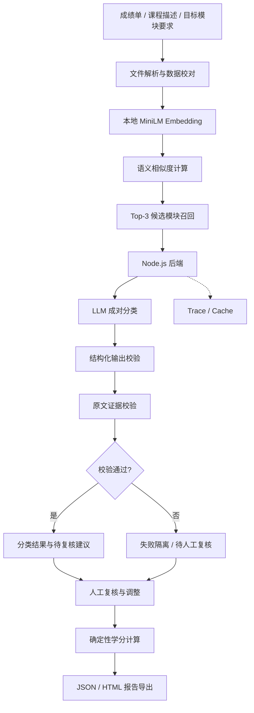
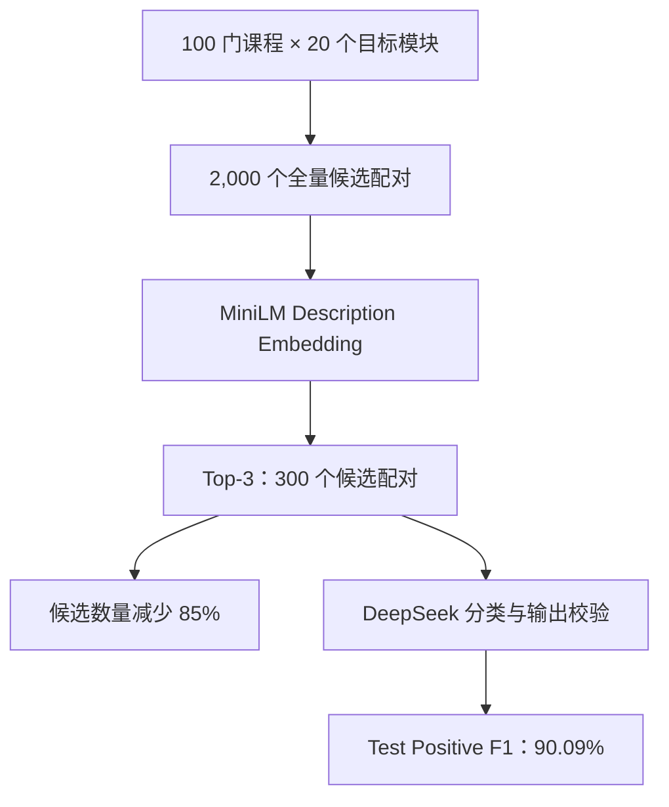

# Academic Course Matching Copilot · LLM Edition

**面向中国本科申请德国硕士课程匹配材料审核的两阶段 LLM 应用：课程描述语义召回 → LLM 成对判定 → 原文证据校验 → 人工复核 → 确定性学分分配。**

## 项目概述

面向中国本科生申请德国硕士的课程匹配需求，开发智能审核辅助系统，自动比对本科已修课程与目标硕士项目的先修课程要求，构建基于语义检索与大语言模型的两阶段课程匹配架构，支持结构化分类、证据引用、人工审核及确定性学分分配。

前端、Node.js 后端、模型文件下载脚本、示例资料、Prompt、校验器、测试与评测脚本均包含在项目中，支持独立部署与实验复现。

本项目不包含 Agent 编排、模型训练或官方录取资格认定。主要工程内容包括两阶段推理、结构化输出契约、证据出处校验、失败隔离、人工复核、可重算业务逻辑及可复现评测。

### 核心成果

| 指标 | 实验结果 |
|---|---:|
| 合成评估基准规模 | 2,000 个标注配对 |
| 测试集 Recall@1 | 96.30% |
| 测试集 Recall@3 | 100% |
| Recall@1 相较 Jaccard 基线提升 | 14.81 个百分点 |
| 候选配对数量削减 | 85% |
| 测试集 LLM 分类准确率 | 87.22% |
| 测试集端到端 Positive F1 | 90.09% |
| 测试集输出校验通过率 | 98.33% |
| 自动化测试 | 18 项通过 |

以上结果来自合成评估基准与真实 DeepSeek API 实验，不代表真实高校学分认定准确率。

## 技术栈

| 模块 | 技术 |
|---|---|
| 编程语言 | JavaScript |
| 后端 | Node.js、RESTful API |
| 前端 | HTML、CSS、JavaScript |
| 语义检索 | Transformers.js、MiniLM、Embedding |
| 本地模型推理 | ONNX Runtime、INT8 量化、CPU |
| 大语言模型 | DeepSeek API |
| 可靠性设计 | JSON Schema、结构化输出校验、证据校验、重试、缓存 |
| 测试与评估 | Node.js Test Runner、Happy DOM、Benchmark V1/V2 |
| 本地存储 | localStorage、JSON、JSONL |

## 系统架构



### 核心设计

- **两阶段语义匹配：** 使用本地量化 MiniLM 模型进行课程描述向量编码与候选检索，再通过 LLM 对候选课程与目标模块进行精细化分类，避免全量穷举匹配。
- **结构化输出契约：** 对模型输出字段、课程编号、模块编号、候选数量、分类结果和证据引用进行严格校验。
- **原文证据校验：** 检查模型生成的引用是否能够在对应原始课程描述及目标模块要求中找到。
- **失败隔离：** 对超时、接口故障、非法输出及伪造引用进行处理，异常结果进入待人工复核状态。
- **人工复核：** 支持人工新增、删除、调整和确认匹配结果。
- **确定性业务规则：** 将学分计算与模型推理解耦，避免重复学分认定，人工修改学分不触发模型重新推理。
- **可观测性：** 记录模型调用状态、Prompt 版本、输入哈希、重试次数、Token 使用量和耗时。
- **缓存机制：** 对有效模型响应进行缓存，减少相同输入和配置下的重复调用。

## 本地运行

需要 Node.js 22.13+，推荐 Node.js 24。打开终端，进入包含 package.json 的项目目录。

```bash
npm run bootstrap
npm run setup
```

`bootstrap` 使用锁文件安装依赖，并通过标准环境变量跳过不需要的 CUDA 下载。它替代旧版有 npm 配置警告的安装方式。

`setup` 会校验模型权重的 SHA-256；从 GitHub 克隆时会下载缺失权重。

### 环境配置

复制 `.env.example` 为 `.env`：

```bash
cp .env.example .env
```

使用编辑器在自己的电脑填写 API 密钥：

```dotenv
LLM_API_BASE=https://api.deepseek.com
LLM_API_KEY=在这里填写你自己的密钥
LLM_MODEL=deepseek-flash
LLM_THINKING_MODE=disabled
LLM_TIMEOUT_MS=45000
PORT=5173
HOST=127.0.0.1
```

不要把真实密钥提交到 GitHub 或发送到聊天。

示例配置使用 DeepSeek 的 Chat Completions JSON 模式，也可配置支持相同 `/chat/completions` 和 JSON object 格式的兼容服务。

Anthropic 原生接口、Responses-only 接口不属于本适配器支持的协议。

### 启动开发环境

```bash
npm run dev
```

打开：

http://127.0.0.1:5173

页面应显示模型配置已读取。点击「体验示例项目」→「开始 LLM 匹配」。

配置读取成功只证明环境变量存在，第一次实际调用才会验证密钥和服务可用性。

修改 `.env` 或 `server/` 后请停止并重启服务。修改 `src/` 后自动重建，刷新浏览器即可。

没有密钥也能运行页面，在「运行方式」中选择 **仅检索预览**。完整模式的判定按钮会保持不可用。

### 构建与启动

```bash
npm run build
npm start
```

本版需要 Node.js 后端处理模型调用，不是仅上传 `dist/` 就能运行完整功能的静态页面。

静态资源采用域名根路径。默认服务仅监听本机地址，没有多用户认证，不要直接作为公网多用户服务开放。

## 如何使用

1. 上传成绩单、课程描述、目标模块要求，或使用 `examples/` 中的三份 CSV。
2. 校对解析结果，确认课程编号一致、描述完整、原始学分正确。
3. 设置学分换算，默认 1 中国学分 = 1.5 ECTS，仅是可调整的估算规则。
4. 完整模式先用本地 MiniLM 对课程描述编码，逐课召回 Top-3 模块。
5. 每门课程与三个候选模块一起交给 LLM，返回匹配分类、判断理由、缺失主题和两侧原文引用。
6. 后端严格检查响应字段、课程及模块编号、候选数量和引用出处。错误输出、伪造引用、超时和接口故障进入待复核状态，不生成可计分建议。
7. 核对候选明细和证据，人工新增、删除或调整匹配与学分，再逐条确认。
8. 导出 JSON 或 HTML 报告，保留判定、校验、运行摘要和人工复核记录。

### 支持的文件格式

| 文件格式 | 支持情况 |
|---|---|
| CSV | 支持 |
| TSV | 支持 |
| JSON | 支持 |
| TXT | 支持 |
| Markdown | 支持 |
| PDF | 支持文字型 PDF |
| DOCX | 支持 |
| 扫描件及图片 | 暂不提供 OCR |

单文件上限 10 MB，每类最多 150 行，PDF 最多 80 页。

复杂 PDF/DOCX 表格需要人工整理。完整 LLM 模式每条描述限制 8,000 字符，长描述在召回阶段最多处理前 8 个片段。

英文描述的 Embedding 效果更稳，中德术语归一化不等于完整翻译。

## LLM 分类机制

系统将课程与目标模块之间的关系划分为四类：

| 分类 | 含义 |
|---|---|
| match | 完全匹配，课程内容能够覆盖目标模块的主要要求 |
| partial | 部分匹配，内容存在相关性但覆盖不完整 |
| no_match | 不匹配，课程内容无法满足目标模块要求 |
| insufficient_evidence | 证据不足，现有材料无法支持可靠判断 |

`needs_review` 为待人工复核状态，不属于新的语义匹配类别。

系统不会直接将向量相似度作为课程内容覆盖比例，也不会将模型输出直接视为最终学分认定结果。

## 学分分配规则

- 每门课程可用预算为 `round(原始学分 × 换算系数, 2)`。
- 仅通过契约和引用校验的 `match` / `partial` 可以生成待复核匹配。
- 只有一个完整 `match` 时，可给它全额预算初稿。
- 多个完整匹配竞争同一门课程时，初始分配均为 0；部分匹配初始也为 0，由用户选择一个模块并整门分配。
- 一门课程只能分配到一个目标模块，不能拆分。
- 每门课程必须为 0 或整门预算，且总额不可超过预算。
- 同一课程、同一模块不能重复添加。
- 修改学分只执行本地 `calculate()`，不调用 Embedding 或 LLM。
- 修改模块会使原 LLM 判断失效，并标记为人工指定。
- 「已分配」包含待复核金额，「已确认」仅包含人工确认的金额。

语义判断与学分分配相互独立。

引用存在只证明出处，不能证明 LLM 推理或课程等价关系一定正确。

## 运行记录与隐私

- 密钥只在 Node.js 后端 `.env` 中读取，不发送给前端。
- 原始文件留在浏览器解析；完整模式会把课程描述、课程名称及目标模块描述发送给配置的模型服务。
- 浏览器 localStorage 保存资料、匹配、判定和运行记录。0.2 使用新的存储命名空间，不覆盖旧版浏览器状态。
- `.data/traces.jsonl` 记录输入哈希、模型、Prompt 版本、尝试次数、状态、Token 与耗时，不记录密钥和原始描述。
- `.data/cache/` 保存有效模型输出，包含引用片段，应视为私人材料。
- 缓存有效期为 24 小时。输入、模型、Prompt 或生成配置变更会导致缓存键变化，读取缓存时会重新验证引用。
- 清除浏览器项目资料不会删除后端缓存。需要彻底移除本地记录时，停止服务后删除 `.data/`。
- 取消操作停止后续请求，已经发出的模型请求可能仍执行并产生费用。
- Token 汇总仅来自服务实际返回的 usage，不是账单保证。

## 自动化测试

```bash
npm test
node eval/validate-benchmark.mjs
```

目前已通过 18 项自动化测试，包括原有 15 项测试和新增 3 项 Benchmark V2 校验测试。

测试覆盖：

- 文件解析与输入数据校验
- 真实 MiniLM 本地推理
- 语义检索与候选排序
- 学分预算与确定性分配规则
- 结构化模型输出校验
- 原文证据与伪造引用校验
- HTTP 接口与测试模型服务联通
- 超时、重试及缓存机制
- 前端完整交互链路
- Benchmark V2 数据完整性与数据泄漏校验

交互测试统计推理与 API 调用次数，确认编辑、确认和导出不会触发新的模型调用。

DOM 测试使用 Happy DOM，自动化 API 测试使用测试模型服务。真实 LLM 实验通过独立评测脚本运行。

## 实验评估

### 1. 实验目标

实验主要研究以下问题：

- 基于课程描述的语义检索是否优于课程名称检索和关键词检索？
- 不同 Top-K 设置如何影响检索召回率与候选数量？
- 本地量化 Embedding 模型的检索性能如何？
- 真实 LLM 在候选课程模块上的分类能力如何？
- 两阶段匹配架构的端到端语义匹配效果如何？
- 结构化输出与证据引用校验的表现如何？

### 2. Benchmark V1 与 V2

| 数据集 | 源课程 | 目标模块 | 标注配对 | Dev | Test |
|---|---:|---:|---:|---:|---:|
| Benchmark V1 | 16 | 6 | 96 | 8 | 8 |
| Benchmark V2 | 100 | 20 | 2,000 | 40 | 60 |

Benchmark V1 为初始合成评估基准，原始实验结果保留不动。

新评测脚本复跑 V1 的关键 K=3 指标，与旧结果完全一致。

Benchmark V2 扩展了课程数量、目标模块数量与语义匹配场景。

#### Benchmark V2 场景分布

| 场景 | 说明 | 课程数量 | 占比 |
|---|---|---:|---:|
| Straightforward | 直接语义匹配 | 25 | 25% |
| Paraphrase | 不同语言表达下的语义匹配 | 25 | 25% |
| Partial | 内容部分覆盖 | 20 | 20% |
| Hard-negative | 词汇相似但语义不匹配的干扰项 | 20 | 20% |
| No valid match | 不存在有效匹配模块 | 10 | 10% |
| 合计 | | 100 | 100% |

Hard-negative 课程包含一个真实匹配模块，以及一个词汇上更接近但明确不覆盖的干扰模块。

无有效匹配课程没有任何正标签。

标签为合成数据，由 `eval/data/generate-v2.mjs` 确定性生成，未经独立人工专家验证。

生成过程、标签口径、数据质量校验与局限见 [Benchmark V2 方法](docs/BENCHMARK.md)。

### 3. 评估指标

检索相关性定义为 `match` 或 `partial`。

没有相关标签的课程不进入 Recall、HitRate 和 MRR 分母。Benchmark V2 中有 10 门此类课程，其中 Dev 4 门、Test 6 门。

- **Recall@K：** 前 K 个检索结果覆盖相关模块的比例，按课程进行宏平均。
- **HitRate@K：** 前 K 个检索结果中至少存在一个相关模块的课程比例。
- **MRR@K：** 首个相关模块出现在前 K 名时的倒数排名，前 K 名没有相关模块记为 0。
- **Accuracy：** 正确分类配对占全部评估配对的比例。
- **Macro-F1：** 对参与统计的分类类别分别计算 F1 后取平均。
- **Positive Precision / Recall / F1：** 将 `match` 和 `partial` 合并为语义相关正类，衡量相关性识别能力。
- **Output Validation Pass Rate：** 通过输出校验的结果占全部预测结果的比例。
- **Citation Validation Pass Rate：** 涉及引用校验的结果中通过现有校验流程的比例。

### 4. 语义检索对照实验

比较三种检索策略：

- Keyword Jaccard：基于关键词集合重叠程度的检索。
- Name Embedding：基于课程名称的语义向量检索。
- Description Embedding：基于课程描述的语义向量检索。

#### Test Split

60 门课程，其中 54 门存在正标签。

| 检索策略 | R@1 | H@1 | MRR@1 | R@3 | H@3 | MRR@3 | R@5 | H@5 | MRR@5 |
|---|---:|---:|---:|---:|---:|---:|---:|---:|---:|
| Name Embedding | 0.722 | 0.722 | 0.722 | 0.889 | 0.889 | 0.799 | 0.981 | 0.981 | 0.822 |
| Description Embedding | **0.963** | **0.963** | **0.963** | **1.000** | **1.000** | **0.981** | **1.000** | **1.000** | **0.981** |
| Keyword Jaccard | 0.815 | 0.815 | 0.815 | 1.000 | 1.000 | 0.898 | 1.000 | 1.000 | 0.898 |

#### Dev Split

40 门课程，其中 36 门存在正标签。

| 检索策略 | R@1 | H@1 | MRR@1 | R@3 | H@3 | MRR@3 | R@5 | H@5 | MRR@5 |
|---|---:|---:|---:|---:|---:|---:|---:|---:|---:|
| Name Embedding | 0.833 | 0.833 | 0.833 | 0.889 | 0.889 | 0.861 | 0.944 | 0.944 | 0.874 |
| Description Embedding | **0.917** | **0.917** | **0.917** | **1.000** | **1.000** | **0.958** | **1.000** | **1.000** | **0.958** |
| Keyword Jaccard | 0.861 | 0.861 | 0.861 | 1.000 | 1.000 | 0.931 | 1.000 | 1.000 | 0.931 |

实验结果表明：

- Description Embedding 在测试集上的 Recall@1 达到 96.30%，较 Jaccard 基线提升 14.81 个百分点。
- Description Embedding 的测试集 MRR@3 为 0.981，较 Jaccard 基线提升约 8.3 个百分点。
- Description Embedding 和 Jaccard 在 K=3、K=5 时均达到 100% 的 Recall 和 HitRate。
- 基于课程名称的 Embedding 检索整体表现相对较弱。

因此，在当前合成评估基准上，课程描述向量检索的主要优势体现在相关模块的排序质量，而非所有 K 值下均具有更高的召回率。

### 5. Top-K 消融实验

在课程描述 Embedding 检索策略下，比较不同 Top-K 设置的召回率与候选数量。

| 设置 | Dev Recall | Test Recall | Dev 候选数 | Test 候选数 | 候选削减比例 |
|---|---:|---:|---:|---:|---:|
| 全量穷举 | 100% | 100% | 800 | 1,200 | 0% |
| Top-1 | 91.67% | 96.30% | 40 | 60 | 95% |
| Top-3 | 100% | 100% | 120 | 180 | 85% |
| Top-5 | 100% | 100% | 200 | 300 | 75% |

在当前评估基准中，Top-3 在保留全部相关候选的同时，有效减少了需要交给 LLM 进行分类的配对数量。



因此系统采用 Top-3 作为默认检索设置。

候选数量削减比例不等于实际 API 调用次数、Token 消耗或费用削减比例。

### 6. 检索性能评估

实验环境：

| 配置 | 参数 |
|---|---|
| CPU | Apple M1 Pro |
| 逻辑核心 | 8 |
| 内存 | 16 GB |
| Node.js | v24.15.0 |
| Embedding 模型 | Xenova/all-MiniLM-L6-v2 |
| 量化方式 | q8 |
| 推理设备 | CPU |
| 重复次数 | 5 |

| 检索策略 | Test 首次运行 | Test 热运行中位数 | Test Embedding 中位数 | Dev 热运行中位数 | Dev Embedding 中位数 |
|---|---:|---:|---:|---:|---:|
| Description Embedding | 310.2 ms | 202.1 ms | 201.4 ms | 147.4 ms | 146.9 ms |
| Name Embedding | 36.5 ms | 35.6 ms | 34.5 ms | 25.1 ms | 24.5 ms |
| Keyword Jaccard | 7.1 ms | 5.6 ms | — | 2.3 ms | — |

描述检索冷启动总计 = 模型加载 + 第一次描述检索。

模型加载单独记录为 Test 93.4 ms / Dev 169.1 ms。

名称与关键词检索在描述检索之后运行，因此其首次运行已处于模型热状态。

以上数据为批量检索实验结果，不是单门课程的请求耗时，也不包含 LLM API 推理时间。

实验在单机、单进程、无 GPU 环境下进行，延迟会受系统负载影响。

### 7. 真实 LLM 分类与端到端评估

在完成检索对照实验的基础上，接入真实 DeepSeek API，对 Benchmark V2 的开发集与独立测试集进行分类和端到端语义匹配评估。

#### 实验配置

| 配置 | 参数 |
|---|---|
| Embedding | Xenova/all-MiniLM-L6-v2 |
| 检索策略 | Description Embedding |
| Candidate Selection | Top-3 |
| LLM | deepseek-flash |
| Prompt Version | course-pair-v1.0 |
| Thinking Mode | disabled |

#### 实验结果

| 评估指标 | Dev | Test |
|---|---:|---:|
| 课程数量 | 40 | 60 |
| 全量评估配对 | 800 | 1,200 |
| LLM 分类配对 | 120 | 180 |
| LLM 分类 Accuracy | 90.83% | 87.22% |
| LLM 分类 Macro-F1 | 84.88% | 76.58% |
| 端到端 Accuracy | 98.63% | 98.08% |
| 端到端 Macro-F1 | 86.17% | 78.03% |
| 端到端 Positive Precision | 87.50% | 87.72% |
| 端到端 Positive Recall | 97.22% | 92.59% |
| 端到端 Positive F1 | 92.11% | **90.09%** |
| 输出校验通过率 | 97.50% | 98.33% |
| 证据引用校验通过率 | 100%（86/86） | 100%（137/137） |
| 待人工复核数量 | 3 | 3 |

LLM 分类指标仅针对检索阶段返回的候选配对。

端到端评估覆盖全部课程与目标模块配对，将 `match` 和 `partial` 合并为语义相关正类，未召回的配对默认按 `no_match` 处理。

由于数据集中负样本占比较高，端到端 Accuracy 容易受到类别不平衡的影响，因此主要采用 Positive Precision、Recall 和 F1 评价系统的语义匹配能力。

### 8. 分类混淆矩阵

#### Dev Split

| 真实标签 / 预测标签 | Match | Partial | No Match | Needs Review |
|---|---:|---:|---:|---:|
| Match | 24 | 3 | 0 | 1 |
| Partial | 0 | 8 | 0 | 0 |
| No Match | 0 | 5 | 77 | 2 |

120 个候选配对中，109 个正确分类。

#### Test Split

| 真实标签 / 预测标签 | Match | Partial | No Match | Needs Review |
|---|---:|---:|---:|---:|
| Match | 30 | 10 | 1 | 1 |
| Partial | 0 | 10 | 2 | 0 |
| No Match | 0 | 7 | 117 | 2 |

180 个候选配对中，157 个正确分类。

### 9. 各类别分类性能

#### Test Split — Retrieved Pairs

| 类别 | Precision | Recall | F1 | Support |
|---|---:|---:|---:|---:|
| Match | 100% | 71.43% | 83.33% | 42 |
| Partial | 37.04% | 83.33% | 51.28% | 12 |
| No Match | 97.50% | 92.86% | 95.12% | 126 |
| Insufficient Evidence | — | — | — | 0 |

#### 端到端相关性识别

| 指标 | Dev | Test |
|---|---:|---:|
| True Positive | 35 | 50 |
| False Positive | 5 | 7 |
| False Negative | 1 | 4 |
| Positive Precision | 87.50% | 87.72% |
| Positive Recall | 97.22% | 92.59% |
| Positive F1 | 92.11% | 90.09% |

### 10. 错误分析

真实 LLM 实验揭示了以下问题。

**完全匹配判断较为保守**

测试集中 30 个被预测为 `match` 的配对均符合基准标签，但有 10 个真实完全匹配样本被降级为 `partial`。

Match 类别具有较高的 Precision，但 Recall 相对较低。

**部分匹配是当前主要分类瓶颈**

测试集 Partial 类别 Precision 为 37.04%，F1 为 51.28%。

模型存在高估部分语义相关性的倾向，将部分完全匹配和不匹配样本归入 Partial 类别。

这说明仅依赖大语言模型判断，仍难以完全解决课程内容覆盖边界的细粒度区分问题。

**人工复核与失败隔离**

Dev 和 Test 共出现 6 个 `needs_review` 结果，未强制将这些结果作为有效匹配输出。

系统通过结构化校验、证据检查和待人工审核状态，避免直接将异常模型输出转换为学分分配建议。

### 11. 输出与证据校验

| 指标 | Dev | Test | 合计 |
|---|---:|---:|---:|
| LLM 分类配对 | 120 | 180 | 300 |
| 输出校验通过数量 | 117 | 177 | 294 |
| 输出校验通过率 | 97.50% | 98.33% | 98.00% |
| 涉及引用校验的结果 | 86 | 137 | 223 |
| 引用校验通过数量 | 86 | 137 | 223 |
| 引用校验通过率 | 100% | 100% | 100% |
| 待人工复核数量 | 3 | 3 | 6 |

证据校验通过仅说明相关输出满足现有校验规则，不代表模型引用的证据一定充分，也不代表其分类结论完全正确。

### 12. 实验结论

在当前合成评估基准下：

- 本地课程描述 Embedding 在测试集上实现 96.30% 的 Recall@1，较关键词基线提升 14.81 个百分点。
- Top-3 检索在保留全部相关候选的情况下，将 2,000 个全量配对减少至 300 个候选配对。
- 真实 DeepSeek 分类实验在独立测试集上实现 87.22% 的候选分类准确率。
- 两阶段匹配架构在独立测试集上实现 90.09% 的端到端语义匹配 Positive F1。
- Dev 和 Test 整体输出校验通过率达到 98%。
- 通过 18 项自动化测试，验证系统的核心功能、可靠性机制及确定性业务规则。

当前系统实现了从文件解析、语义检索、LLM 分类、输出校验到人工审核与学分计算的完整应用流程，并通过可复现基准对检索与语义匹配能力进行了量化评估。

### 13. 实验局限性

- Benchmark V2 为合成数据集，未经独立人工专家验证。
- 合成数据的场景设计与标签口径包含作者判断，无法完整覆盖真实高校课程匹配场景。
- Hard-negative 设计在 Dev Split 上进行了难度 sanity check。
- 当前数据集中每门存在正标签的课程只有一个相关目标模块，尚未充分评估多正标签检索场景。
- 当前基准缺少 `insufficient_evidence` 类别的真实标签样本，尚不能全面评价全部四种语义分类能力。
- Keyword Jaccard 基线主要针对英文词汇设计，对中文、德语特殊字符等多语言场景缺乏充分验证。
- 当前 LLM 实验未进行多随机种子重复评估或统计显著性检验。
- 当前端到端指标衡量的是语义匹配能力，而非最终高校学分认定或录取资格判断的准确率。
- 证据引用校验无法保证模型语义推理的正确性。
- 候选数量削减 85% 不能直接视为 API 费用降低 85%。
- 尚未汇总真实 LLM 实验中的 Token 消耗、API 费用和推理延迟。
- 自动化 DOM 测试与真实模型离线实验不等于真实浏览器环境中的完整业务验收。
- 尚未完成真实高校课程材料的独立人工专家评测。

## 实验复现

### 自动化测试与数据校验

```bash
npm test
node eval/validate-benchmark.mjs
```

### Benchmark V2 检索实验

```bash
npm run eval -- --split=dev --dataset=eval/data/benchmark-v2.json
npm run eval -- --split=test --dataset=eval/data/benchmark-v2.json
```

### Benchmark V1 向后兼容验证

写入临时目录，不覆盖原始 Benchmark V1 实验结果。

```bash
npm run eval -- --split=dev --dataset=eval/data/seed.json --out=/tmp/v1-dev-retrieval.json
npm run eval -- --split=test --dataset=eval/data/seed.json --out=/tmp/v1-test-retrieval.json
```

### 真实 LLM 分类评估

配置 `.env` 后运行：

```bash
npm run eval -- --split=dev --dataset=eval/data/benchmark-v2.json --llm
npm run eval -- --split=test --dataset=eval/data/benchmark-v2.json --llm
```

真实 LLM 评测可能产生 API 调用费用。

未配置密钥时直接报错，不生成虚假模型分数。

评测报告包含分类混淆矩阵、分类 Precision / Recall / F1、端到端相关性指标、输出校验结果、引用校验结果、运行记录与模型服务返回的 usage 信息。

检索实验报告中的 LLM 状态为 `not_run`，真实模型实验报告中的 LLM 状态为 `live_provider`。

### 原始实验结果

| 实验 | Dev | Test |
|---|---|---|
| Benchmark V1 检索实验 | [Dev](eval/results/dev-retrieval.json) | [Test](eval/results/test-retrieval.json) |
| Benchmark V2 检索实验 | [Dev](eval/results/v2-dev-retrieval.json) | [Test](eval/results/v2-test-retrieval.json) |
| Benchmark V2 真实 LLM 实验 | [Dev](eval/results/v2-dev-live.json) | [Test](eval/results/v2-test-live.json) |

## 源码结构

```text
src/
  app.js                  页面交互、两阶段流程与浏览器状态
  core.js                 解析、描述召回与确定性学分计算
  proposals.js            通过校验的判定与保守分配初稿
  semantic-worker.js      本地 MiniLM 推理
  index.html
  styles.css

server/
  prompt.mjs              版本化 Prompt
  validation.mjs          输入契约、输出契约与原文引用校验
  classifier.mjs          模型适配器、重试、缓存与 Trace
  api.mjs                 后端 API、同源检查与请求大小限制
  config.mjs              后端环境变量读取

scripts/
  install.mjs             跨平台 CPU 依赖安装
  download-model.mjs      固定版本模型下载与 SHA-256 校验
  build.mjs               项目构建
  server.mjs              服务启动
  dev.mjs                 开发环境
  evaluate.mjs            检索与真实 LLM 分类评测

eval/
  data/
    seed.json             Benchmark V1 合成数据与标签
    benchmark-v2.json     Benchmark V2 评估基准
    generate-v2.mjs       Benchmark V2 确定性数据生成器
  validate-benchmark.mjs  数据结构、标签、场景与泄漏校验
  metrics.mjs             评估指标计算
  results/
    dev-retrieval.json
    test-retrieval.json
    v2-dev-retrieval.json
    v2-test-retrieval.json
    v2-dev-live.json
    v2-test-live.json

tests/                    单元、模型、HTTP、交互与基准校验测试
examples/                 示例课程匹配资料
docs/                     架构、API、评估、验收与面试说明
licenses/                 第三方模型及依赖许可证

.env.example              环境变量配置示例
model-manifest.json       模型版本与校验和
package.json              项目依赖与运行脚本
README.md                 项目说明
```

## 项目文档

- [架构与设计取舍](docs/ARCHITECTURE.md)
- [API 与错误处理](docs/API.md)
- [实验评估与结果分析](docs/EVALUATION.md)
- [Benchmark V2 方法与质量校验](docs/BENCHMARK.md)


## License

自有代码使用 MIT License。

第三方模型及依赖库保留各自许可证，详见 `licenses/`。

模型固定版本与校验和见 `model-manifest.json`。

## 参考资料

- [Transformers.js](https://huggingface.co/docs/transformers.js)
- [MiniLM — all-MiniLM-L6-v2](https://huggingface.co/sentence-transformers/all-MiniLM-L6-v2)
- [ONNX Runtime](https://onnxruntime.ai/)
- [DeepSeek API Documentation](https://api-docs.deepseek.com/zh-cn/)
- [DeepSeek JSON Output](https://api-docs.deepseek.com/guides/json_mode/)
- [DeepSeek Chat Completion API](https://api-docs.deepseek.com/api/create-chat-completion/)

模型名称与服务支持可能变化，可通过 `.env` 调整，不要将编程助手的 Harness 本身当作本应用的模型 API。

---

本项目为个人 AI 应用开发与工程实践项目，仅用于课程匹配辅助、技术研究与实验评估，不构成任何高校官方学分认定或录取资格结论。
