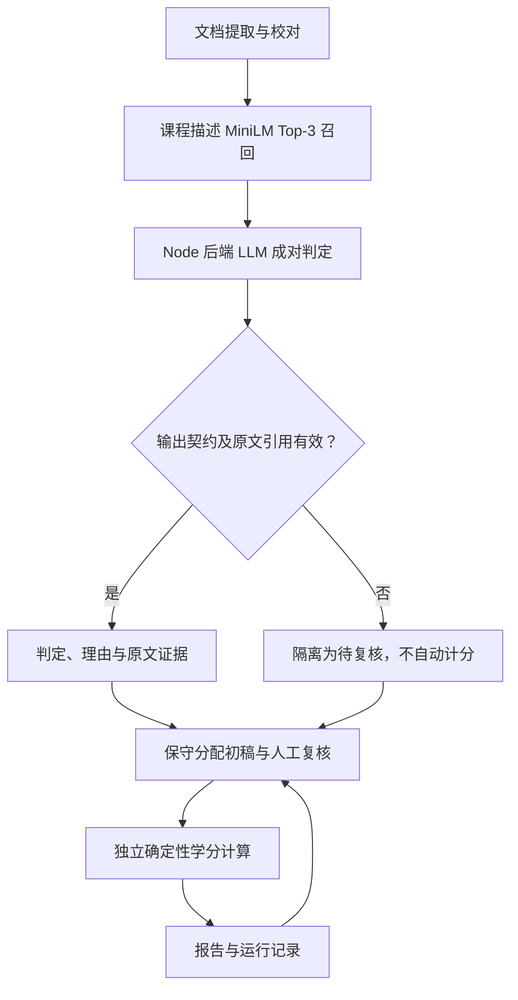

# 两阶段匹配架构

## 职责边界

浏览器负责文件解析、本地召回、人工操作和学分计算；Node 后端持有模型密钥并验证输出。LLM 只提供内容相关性的建议，不拥有修改学分、确认匹配或执行工具的权限。

`core.js` 中的 `matchCourses()` 名称沿用旧版接口，现只返回 Top-3 candidates，`edges` 恒为空，避免检索建议跳过 LLM 校验。名称不参与描述 embedding。分段按字符近似控制长度，每条最多 8 块；记录向量为片段向量均值。检索分数使用完整精度排序，界面才取整显示。

每门课的三个候选放在一次请求中判定，输出仍是逐个课程—模块组合的结构化 assessment。这减少逐对请求的次数，但并不保证比单对 Prompt 更准确，需要另做实验。

## 结构化输出与证据

契约详见 `server/validation.mjs`。四类结果为 match / partial / no_match / insufficient_evidence。所有目标模块必须恰好出现一次；拒绝未知字段、额外课程、额外模块、重复模块、错误编号和非法判断值。

正向结果必须有两侧原文引用。校验只归一化空白，不进行语义相似匹配或翻译匹配；引用长度限制为 8–800 字符。出错结果转为 needs_review，清空不可信引用，保留错误代码。

不匹配或证据不足允许空引用；若返回非空引用仍必须校验。校验通过表示响应符合契约且引用可定位，不能证明理由成立或覆盖深度充分。用户仍需复核。

上传文字作为不可信数据放在 user 消息中，system Prompt 明确禁止执行文档中的指令。该提示加契约校验不能保证消除所有语义层面的提示注入；本项目不宣称已通过全面的攻击评测。

## 分配与修改

`proposals.js` 只接受通过校验的正向判定。唯一 match 可以得到全额初稿；多个 match 或 partial 需要明确的人工金额，初始为 0。所有状态仍为 pending。

`calculate()` 校验同课预算、重复边、有效引用、金额非负与两位小数，分别计算 provisional / confirmed 合计。人工修改无需调用模型。更换模块时会移除原 LLM 判断的适用性，保留人工判断标识；修改金额会重开人工复核。更改系数只按确定性比例调整预算与金额。

当前没有求解最优分配的整数规划，也不按相似度估算课程内容占比。任意人工覆盖都明确标注，不能被当成通过了 LLM 校验的决策。

## 模型调用、缓存与记录

配置仅来自服务进程的 `.env`；浏览器不能提交 API 地址、模型密钥或额外 Prompt。请求只允许课程和模块的编号、名称、描述。原始文件、成绩和学分不会发送给 LLM。

- 默认非流式 Chat Completions JSON object 模式。
- 每次超时默认 45 秒；429、5xx、网络失败最多尝试两次。
- 401/403 不重试。格式/引用错误不额外调用修复模型，直接交人工复核。
- 成功结果按输入、模型、Prompt 版本、生成配置哈希缓存 24 小时；缓存读取重新验证引用。
- 同一进程并发相同请求可合并。缓存不承担认证职责，本项目没有多用户授权系统。
- trace 记录请求 ID、输入哈希、Prompt/模型、状态、每次尝试耗时和 usage。不写密钥或完整资料。
- 存储失败记录 warning，不为写缓存失败重新调用付费模型。

模型别名背后的版本可能变化；live 评测记录服务返回的 providerModel，复现实验时应优先使用服务支持的固定版本。缓存会影响端到端耗时，报告必须区分 cache hit 和实际推理。

## 网络边界与限制

仅默认绑定 127.0.0.1；API 拒绝浏览器跨源调用，限制 128 KB 请求、1–3 个候选、每条描述 8000 字符，以及同时处理的请求数。对外模型连接要求 HTTPS，本地测试/本地模型服务可使用 loopback HTTP。服务地址只由本机配置决定。

这些措施服务于本地单用户工作流，不替代公网部署的用户认证、权限、限流和数据库隔离。前端取消不能保证取消已送达服务商的推理请求。
